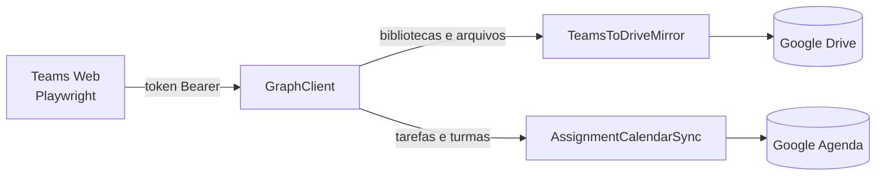

# Automação Fatec

Puxa o material das suas equipes do Teams para o Drive e transforma cada prazo de tarefa em um evento na agenda. Menos caça ao tesouro, mais tempo pra estudar.


---

## O que é isso?

Um script de linha de comando em Python feito para quem estuda na Fatec e usa o Microsoft Teams. Os materiais de cada disciplina ficam espalhados em bibliotecas de documentos, e os prazos só aparecem na aba de tarefas. O projeto resolve as duas coisas:

1. Espelha, de forma incremental, as bibliotecas de cada equipe numa pasta do Google Drive, organizada por disciplina.
2. Cria um evento no Google Agenda para cada tarefa com prazo, com lembretes.

Pode rodar quantas vezes quiser: arquivos e eventos não são duplicados.

## Funcionalidades

**Arquivos**
- Percorre todas as bibliotecas de cada equipe, incluindo subpastas
- Mantém a mesma hierarquia de pastas no Drive
- Pula o que já foi enviado e segue a paginação da Graph API
- Repete automaticamente requisições com erro 429 ou 5xx

**Agenda**
- Um bloco de duração configurável que termina no prazo da tarefa
- Lembretes configuráveis (padrão: 1 dia e 2 horas antes)
- O evento é identificado pelo ID da tarefa, então mudar o prazo atualiza o evento em vez de criar outro
- Eventos de versões antigas são migrados, não duplicados

## Arquitetura e stack



| Módulo | Responsabilidade |
|---|---|
| `config.py` | Leitura e validação do `config.toml` |
| `google_auth.py` | OAuth 2.0 para Drive e Agenda, com escopos mínimos |
| `teams.py` | Captura do token e cliente da Graph API (timeout, paginação, tentativas) |
| `drive_sync.py` | Espelhamento recursivo das bibliotecas para o Drive |
| `calendar_sync.py` | Conversão de tarefas em eventos |
| `cli.py` | Interface de linha de comando |

**Backend:** Python 3.11+, `requests` para a Graph API, `google-api-python-client` para Drive e Agenda, Playwright para a sessão do Teams.

**Idempotência:** cada pasta do Drive é listada uma única vez (com cache) e os eventos guardam o ID da tarefa em `extendedProperties.private`.

## Instalação

**1. Clone e crie o ambiente**
```bash
git clone https://github.com/pedrohl45/automacao-fatec.git
cd automacao-fatec
python -m venv venv
source venv/bin/activate
pip install -e .
playwright install chromium
```

**2. Credenciais do Google**
- No [Google Cloud Console](https://console.cloud.google.com/), crie um projeto e ative as APIs do Drive e do Calendar
- Crie um *OAuth client ID* do tipo **Desktop app** e baixe o JSON como `credentials.json` (o formato está em `credentials.example.json`)

**3. Configuração**
```bash
cp config.example.toml config.toml
```

Preencha o ID da pasta do Drive e o ID do grupo de cada equipe. O ID do grupo aparece na URL da equipe no Teams Web (parâmetro `groupId`).

| Chave | Descrição | Padrão |
|---|---|---|
| `drive_folder_id` | Pasta do Drive que receberá os arquivos (último trecho da URL) | obrigatório |
| `credentials_file` | JSON de credenciais OAuth do Google | `credentials.json` |
| `token_file` | Token do Google gerado após o consentimento | `token.json` |
| `session_dir` | Perfil do navegador usado para o login no Teams | `teams_session` |
| `token_wait_seconds` | Tempo máximo de espera pela captura do token | `180` |
| `token_settle_seconds` | Segundos sem novos tokens para encerrar a captura (mantém o mais recente) | `20` |
| `[courses]` | Mapeia o nome da disciplina ao ID do grupo no Teams | obrigatório |
| `[calendar].event_duration_hours` | Duração do bloco que termina no prazo | `2` |
| `[calendar].color_id` | Cor do evento no Google Agenda | `"11"` |
| `[calendar].reminders_minutes` | Lembretes, em minutos antes do início | `[1440, 120]` |

## Uso

```bash
automacao-fatec                  # sincroniza arquivos e tarefas
automacao-fatec --skip-files     # só tarefas
automacao-fatec --skip-calendar  # só arquivos
automacao-fatec -v               # log detalhado
```

Ao rodar, uma janela do navegador abre o Teams. Faça login (a sessão fica salva em `teams_session/`) e abra a aba **Arquivos** de qualquer equipe para que o Teams emita a chamada da qual o token é extraído.

Na primeira execução o navegador também abre o consentimento do Google e gera o `token.json`.

## Testes

```bash
pip install -r requirements-dev.txt
pytest
ruff check src tests
```

Os testes cobrem a lógica pura: conversão de datas, construção e comparação de eventos, escape de consultas, paginação com cache e leitura de configuração. As integrações com Google e Microsoft não têm teste automatizado porque dependem de contas reais.

## Limitações e avisos

- **O token vem do navegador.** O programa intercepta o token que o próprio Teams Web usa nas chamadas à Graph API. Ele foi emitido para o cliente do Teams, não para este app, e esse uso pode não estar de acordo com os termos da Microsoft nem com as políticas de TI da instituição. Use só com a sua própria conta e com os seus próprios dados. O caminho correto é registrar um app no Microsoft Entra ID e autenticar com MSAL (*device code flow*), o que depende de o administrador do tenant liberar o consentimento.
- **Tarefas são experimentais.** Os endpoints da Education API (`education/me/assignments` e `education/me/classes`) podem responder 403 dependendo das permissões do token e da configuração da instituição.
- **Mudanças em arquivos não são detectadas.** A comparação é só por nome: uma versão nova de um arquivo com o mesmo nome não substitui a antiga.
- **Bibliotecas agregadas.** Todas as bibliotecas de uma equipe vão para a mesma pasta da disciplina, então arquivos com o mesmo nome em bibliotecas diferentes colidem.
- **Depende do Teams Web.** Se a interface mudar, a captura do token pode parar de funcionar.
- **Sessão do Google.** Enquanto o app OAuth estiver em modo de teste, o Google expira o consentimento em 7 dias.
- **Dados sensíveis.** `credentials.json`, `token.json`, `config.toml` e `teams_session/` estão no `.gitignore`. Nunca suba esses arquivos.

## Próximos passos

- [ ] Autenticação via MSAL, sem captura de token
- [ ] Detectar versões novas por hash ou data de modificação
- [ ] Modo `--dry-run` que mostra o que seria feito
- [ ] Execução agendada (cron ou systemd)

## Referências

- [Microsoft Graph REST API v1.0](https://learn.microsoft.com/graph/api/overview)
- [Education API (Graph)](https://learn.microsoft.com/graph/api/resources/education-overview)
- [Google Drive API v3](https://developers.google.com/drive/api/v3/reference)
- [Google Calendar API, propriedades estendidas](https://developers.google.com/calendar/api/guides/extended-properties)

## Licença

MIT. O texto original, em inglês, está em [LICENSE](LICENSE).

---

Feito por [Pedro Henrique](https://github.com/pedrohl45) para quem já perdeu um prazo porque ele estava escondido numa aba.
